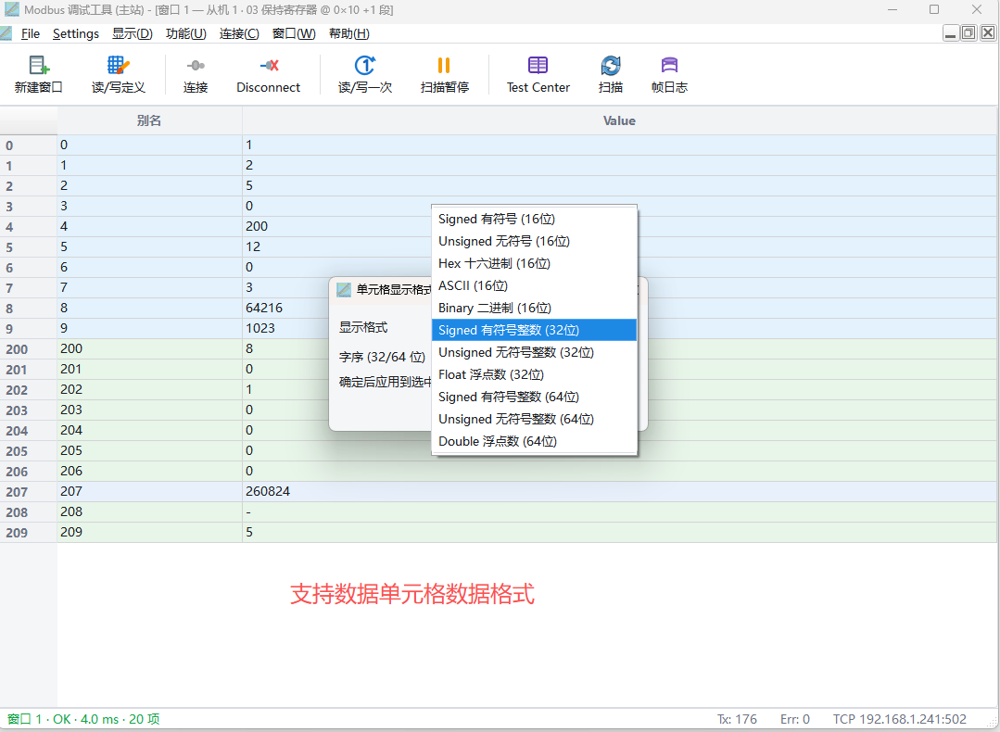
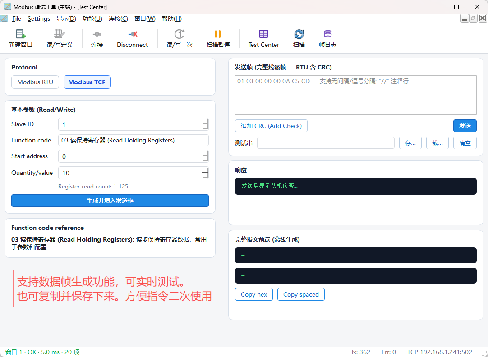
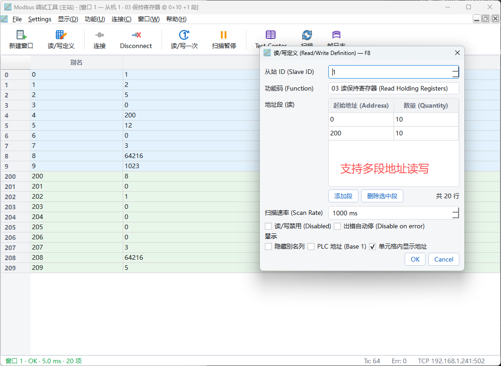
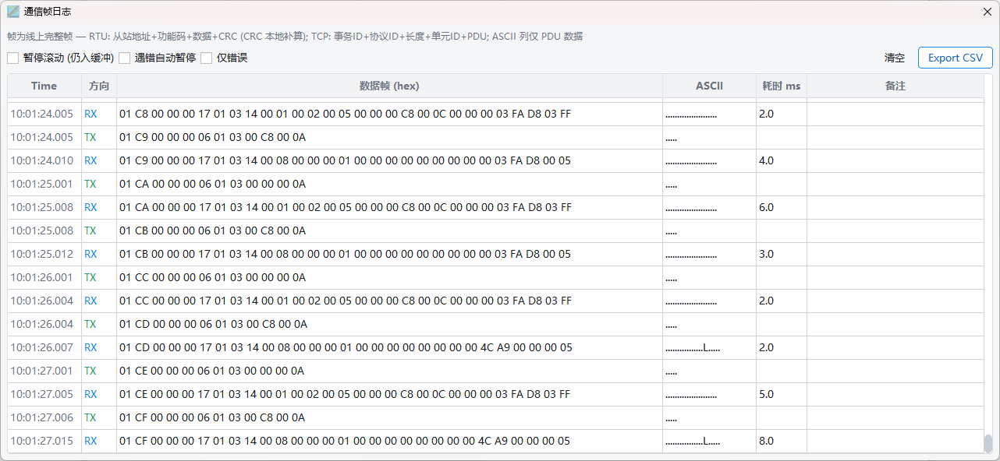

# STModbusTools — Modbus 主站调试工具 | Modbus Master Debug Tool

[简体中文](#简体中文) | [English](#english)

---

## 简体中文

开源的 Modbus 主站调试软件，操作逻辑对标 Modbus Poll。支持 RTU / TCP 多连接、
多从站轮询、PLC 风格数据窗口、Test Center 报文调试、从站扫描与完整帧日志，
基于 Qt 6，Windows / macOS 开箱可用。

### 截图

| | |
|---|---|
|  |  |
|  |  |

### 功能

- **多机连接 (设备树)**：多个串口 / TCP 连接并存，左侧设备树统一管理；
  每个连接一个节点 (绿点 = 已连接, 红点 = 未连接), 树中选中 = 活动连接
  (F3 / 连接 / 断开 / 扫描 / Test Center 的作用对象)
- **串口多从机**：一个串口连接下按从机地址挂多台设备, 两种配置方式 —
  数量模式 (指定 N, 地址 1..N 依次轮询) / 手动模式 (地址列表, 支持
  `1,3,5-8` 范围写法); 每台从机 FC03 探测, 子节点状态点显示在线/离线
  (双击从机 = 以该连接+从机新建数据窗口)
- **Modbus RTU / TCP 主站**：数据窗口按连接绑定, 多连接的窗口同时轮询互不干扰
- **数据窗口**：定义表格（Coil/Discrete/Input/Holding 四区，PLC 风格地址可选）、
  十六进制/浮点/整型多种显示格式、表内别名重命名
- **单元格样式**：字体大小/粗斜下划线、行高、背景色（选中行 = 行级覆盖，
  无选中 = 窗口级默认）与列宽/行头宽；**鼠标拖动行头/列头边界即改即存**
  （双击边界 = 自适应内容），随工作区持久化；行级手动背景绝对优先于
  条件变色与段底色
- **缩放与前缀/后缀**：Y = m(X−X1)+Y1 数值缩放与单位前后缀
  （如 `12.5 V`，选中行可单独覆盖、空覆盖 = 该行去单位）；
  写窗口编辑输入自动剥离前后缀再解析
- **Test Center**：结构化生成 + 原始帧收发（追加 CRC / 报文预览 / 响应解析）
- **从站扫描**：地址段批量探测
- **串口参数扫描**：波特率 × 校验 × 停止位组合逐个重开串口探测从站
  （数据位固定 8, RTU 标准），探测顺序按常见度优先，找到即回填连接参数
- **Modbus TCP 发现**：指定端口（默认 502）按网段并行探端口，开放主机
  再逐单元 ID 探测，结果一键回填 IP/端口/从站
- **帧日志**：RTU ADU / TCP MBAP 完整帧展示与错误统计（全部连接混排）
- **工作区**：多连接 + 从机列表 + 全部窗口定义，JSON 文件保存/恢复
  （v3 格式, 自动兼容加载 v1/v2 旧工作区）
- 扫描共用「无应答超时」设置（默认 100 ms，超时即跳下一个，可调）
- 双语界面（中文源码，English 随包 `ModbusTools_en.qm`）

> 趋势图功能已移除（其唯一依赖 Qt Charts 为 GPL-3.0-only，与闭源商业分发
> 冲突）；趋势查看可用数据窗口的「记录」CSV 导出替代。

### 构建 (Qt 6, CMake ≥ 3.21)

```bash
# macOS / Linux
cmake -S . -B build -DCMAKE_BUILD_TYPE=Release
cmake --build build

# Windows (MinGW)
cmake -S . -B build -DCMAKE_BUILD_TYPE=Release
cmake --build build
```

依赖：Qt 6 模块 Widgets / SerialBus / SerialPort（+ LinguistTools 构建）。

### 测试

```bash
ctest --test-dir build
```

`tst_modbustools` 覆盖：显示格式纯逻辑、定义序列化（v1/v2/v3）、表格模型、
主窗与 Test Center 离屏冒烟、帧日志 RTU ADU / TCP MBAP 展示、TCP 回环
TID 镜像、连接注册表 / 从机在线轮询（回环从机）/ 设备树装配 / 双连接
同时轮询互不串扰；接入实机时自动执行实机全功能用例（否则跳过）。

联调用模拟器：`python3 scripts/modbus_sim.py [--channels 16] [--port 1502]`
（标准数字变送器寄存器布局，纯标准库）。

### 打包

- **Windows**：`cmake --build build --target all dist && cd build && cpack`
  → ZIP / NSIS 安装包（windeployqt 平铺布局，许可随附）
- **macOS**：`cmake --build build --target dist`
  → `STModbusTools-<版本>-macos-arm64.dmg`（macdeployqt + ad-hoc 签名）

### 历史说明

- 本项目源自一套内部称重测力调试软件（WeightTool）的 Modbus 调试工具模块，
  现已独立演进，与原项目互不依赖
- QSettings 组织名 `ST072G`、应用名 `ModbusTools`（历史名，产品已更名
  STModbusTools）、macOS bundle id `com.st072g.modbustools` 等为历史遗留
  标识符：为保证老用户设置迁移与工作区文件向后兼容而保留，无其他含义

### 开发

构建约定、目录分层与关键约束见 [AGENTS.md](AGENTS.md)。GitHub Actions
对 Windows (MSVC) 与 macOS (arm64) 双平台自动构建并运行测试
（`.github/workflows/ci.yml`）。

### 许可

- 本项目代码以 [MIT](LICENSE) 许可发布
- 运行时依赖的 Qt 6 模块以 LGPL-3.0 **动态链接**（未修改 Qt 任何部分，
  不含 GPL-only 模块，如 Qt Charts），允许闭源分发；第三方组件义务与
  随附文本见 [LICENSES/THIRD-PARTY-NOTICES.md](LICENSES/THIRD-PARTY-NOTICES.md)

---

## English

An open-source Modbus master debugging tool modeled after Modbus Poll.
It supports multiple RTU / TCP connections, multi-slave polling, PLC-style
data windows, Test Center frame debugging, slave scanning and full frame
logging. Built on Qt 6, ready to run on Windows and macOS.

### Screenshots

| | |
|---|---|
|  |  |
|  |  |

### Features

- **Multi-connection device tree**: several serial / TCP connections side by
  side, managed in a tree on the left; one node per connection (green dot =
  connected, red dot = disconnected); the selected node is the active
  connection (target of F3 / Connect / Disconnect / Scan / Test Center)
- **Multiple slaves per serial port**: attach devices by slave address under
  one serial connection, configured either by count (N slaves polled as
  1..N) or by an explicit address list supporting `1,3,5-8` ranges; each
  slave is probed with FC03 and shown online/offline in the tree (double
  click = new data window for that connection + slave)
- **Modbus RTU / TCP master**: data windows are bound to connections;
  windows on multiple connections poll concurrently without interference
- **Data window**: definition table (Coil / Discrete / Input / Holding with
  optional PLC-style addressing), hex / float / integer display formats,
  in-table alias renaming
- **Cell styling**: font size / bold / italic / underline, row height,
  background color (selected row = row-level override, no selection =
  window-level default) and column / row-header widths; **drag row/column
  header borders to resize, saved on the spot** (double click = fit to
  content), persisted with the workspace; manual row background takes
  absolute precedence over conditional coloring and band coloring
- **Scaling & prefix/suffix**: linear scaling Y = m(X−X1)+Y1 with unit
  prefix/suffix (e.g. `12.5 V`); per-row overrides supported, an empty
  override removes the unit for that row; write-window input strips the
  prefix/suffix before parsing
- **Test Center**: structured request generation plus raw frame send/receive
  (CRC append / frame preview / response parsing)
- **Slave scan**: batch probing over an address range
- **Serial parameter scan**: probes baud × parity × stop-bit combinations,
  reopening the port for each (8 data bits fixed, per RTU standard); common
  combinations are tried first and connection parameters are filled in
  automatically on success
- **Modbus TCP discovery**: scans a subnet for open ports (default 502) in
  parallel, then probes unit IDs on reachable hosts; results fill in
  IP / port / slave in one click
- **Frame log**: complete RTU ADU / TCP MBAP frames with error statistics
  (mixed across all connections)
- **Workspace**: multiple connections + slave lists + all window
  definitions, saved/restored as JSON (v3 format; v1/v2 workspaces load
  transparently)
- Scans share the "response timeout" setting (default 100 ms, adjustable;
  timeout skips to the next candidate)
- Bilingual UI (Chinese source, English via bundled `ModbusTools_en.qm`)

> The trend-chart feature was removed because its only dependency, Qt Charts,
> is GPL-3.0-only, which conflicts with closed-source commercial
> distribution. Use the data window's "record" CSV export instead.

### Build (Qt 6, CMake ≥ 3.21)

```bash
cmake -S . -B build -DCMAKE_BUILD_TYPE=Release
cmake --build build
```

Dependencies: Qt 6 modules Widgets / SerialBus / SerialPort (+ LinguistTools
for building).

### Tests

```bash
ctest --test-dir build
```

`tst_modbustools` covers: display-format pure logic, definition
serialization (v1/v2/v3), table model, offscreen smoke tests of the main
window and Test Center, frame log RTU ADU / TCP MBAP rendering, TCP loopback
TID mirroring, connection registry / slave online polling (loopback slave) /
device tree assembly / concurrent polling of two connections; on-hardware
test cases run automatically when real hardware is attached (skipped
otherwise).

For debugging, a pure-stdlib Modbus TCP simulator is included:
`python3 scripts/modbus_sim.py [--channels 16] [--port 1502]`.

### Packaging

- **Windows**: `cmake --build build --target all dist && cd build && cpack`
  → ZIP / NSIS installer (windeployqt flat layout, licenses bundled)
- **macOS**: `cmake --build build --target dist`
  → `STModbusTools-<version>-macos-arm64.dmg` (macdeployqt + ad-hoc signing)

### History

- This project originates from the Modbus debugging module of an internal
  weighing & force-measurement debugging tool (WeightTool) and has since
  evolved independently
- Legacy identifiers such as the QSettings organization name `ST072G`, the
  QSettings application name `ModbusTools` (historical name; the product has
  been renamed STModbusTools) and the macOS bundle id
  `com.st072g.modbustools` are kept for backward compatibility with existing
  user settings and workspace files; they carry no other meaning

### Development

Build conventions, layering and key constraints are documented in
[AGENTS.md](AGENTS.md). GitHub Actions builds and tests the project
automatically on Windows (MSVC) and macOS (arm64)
(`.github/workflows/ci.yml`).

### License

- This project's code is released under the [MIT](LICENSE) license
- The Qt 6 modules it links against are used via **dynamic linking** under
  LGPL-3.0 (unmodified Qt, no GPL-only modules such as Qt Charts), which
  permits closed-source distribution; third-party obligations and bundled
  texts are described in
  [LICENSES/THIRD-PARTY-NOTICES.md](LICENSES/THIRD-PARTY-NOTICES.md)
